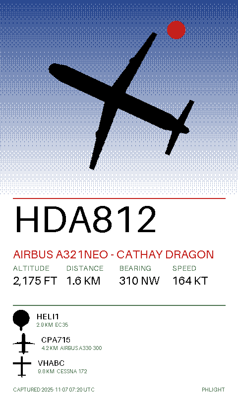
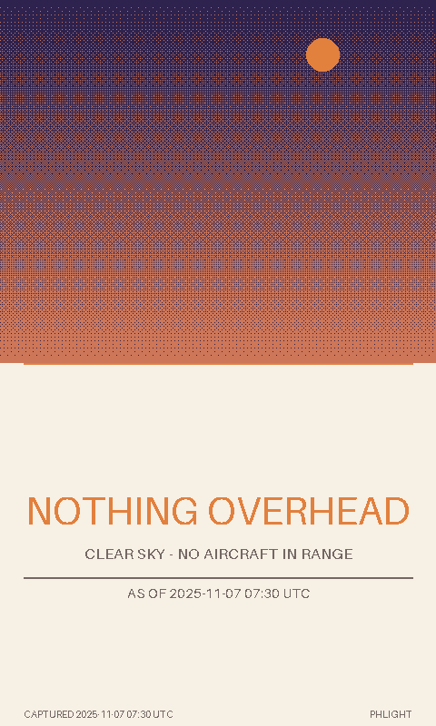

# Phlight

Phlight is a planned framed 7.3-inch color e-paper portrait showing aircraft detected overhead by an integrated ADS-B receiver. Inspired by [FlightPortrait](https://flightportrait.com/), it is intended to be a single hangable object, not a dashboard or an external receiver box.

## Initial direction

- **Power:** USB-powered for continuous reception; not a battery-life commitment.
- **Hardware:** a small Linux computer, a 1090 MHz ADS-B receiver, and antenna mounted inside or on the back of the frame. A Raspberry Pi Zero 2 W and a compact RTL-SDR-class receiver are candidates, not confirmed parts.
- **Display:** 7.3-inch color e-paper and an appropriate driver; select and verify an exact panel before fixing resolution or enclosure dimensions.
- **Software:** receive aircraft positions locally, select nearby/overhead traffic, compose original artwork, and periodically refresh the display. The intended initial prototype uses Linux and Python with an existing ADS-B decoder.
- **Enclosure:** allow a radio-transparent antenna area, cooling, service access, and space for power and receiver hardware. Reception and wall placement must be tested in the finished enclosure.

These choices are provisional until the hardware is tested. Aircraft outside receiver coverage or without usable position reports will not appear. A continuously powered receiver does not imply continuous e-paper refresh.

## Software: portrait renderer (implemented)

`phlight/render/` is the composition stage, as an offline, deterministic
renderer: local aircraft JSON in, one PNG out.

```bash
python -m pip install pillow pytest
python -m phlight.render.cli fixtures/overhead_snapshot.json --out out/portrait.png
python -m phlight.render.cli fixtures/empty_sky_snapshot.json --out out/empty.png --palette dusk
python -m phlight.render.cli fixtures/overhead_snapshot.json --out out/stale.png --palette spectra6 --now 1762501800
python -m pytest
```

- Canvas size and palette are configuration, not constants: `--width`,
  `--height`, `--palette` (`ink`, `spectra6`, `dusk`, or a custom `Palette`).
- Three explicit states: `current`, `empty` (nothing overhead, or forced) and
  `stale` (snapshot older than the caller's threshold, labelled on the image).
- Artwork is original parametric geometry generated in this repository; text
  uses the Aileron font bundled inside Pillow. No third-party or FlightPortrait
  artwork is redistributed.
- Data model, interface, palette roles, and limitations:
  [docs/portrait-renderer.md](docs/portrait-renderer.md).

| portrait, `spectra6` | empty sky, `dusk` |
| --- | --- |
|  |  |

No display panel has been selected and nothing here has been rendered to
e-paper hardware; these are RGB previews, not panel validation.

## Work tracking

The dedicated Hermes Kanban board is `phlight`. The first tasks cover hardware research, receiver ingestion, artwork/rendering, enclosure integration, and end-to-end verification. See [project brief](docs/project-brief.md) for acceptance criteria.

## Reference and licensing

[FlightPortrait's firmware and device protocol](https://github.com/flightportrait/frame) are useful architectural references. Do not copy proprietary artwork; create original art or use assets with verified compatible licenses. If upstream code or data is reused, check and preserve the applicable license and attribution first.

## Status

Project started; no working receiver, display driver, enclosure, or end-to-end
prototype has been verified yet. No hardware has been purchased. The offline
portrait renderer exists, has automated tests, and produces sample images
([docs/portrait-renderer.md](docs/portrait-renderer.md)), but it has never been
displayed on a physical panel.
